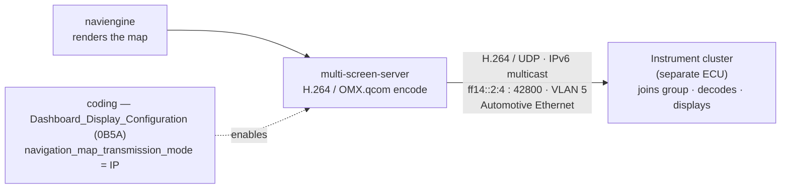

# MIB3 "MOI3" (LG) — Research Notes

> Open reverse-engineering notes on the **LG-built "MOI3"** variant of the Volkswagen Group **MIB3** infotainment platform — how the navigation map reaches the instrument cluster, the platform architecture, the firmware structure, and the coding model.

---

**TL;DR** — MIB3 ships as two very different machines. Almost everything public documents the **Harman MHI2** one (MOST bus, QNX). This repo is about the **other** one — **LG + Qualcomm + Automotive Grade Linux, with Ethernet video to the cluster** — which is barely documented anywhere. Everything here is **read-only** research from public documents and firmware analysis; **defeating device protections is out of scope.**

## 🧭 How the native map reaches the cluster

> The head unit (`5F`) renders the map, H.264-encodes it, and streams it as IPv6-multicast video over Automotive Ethernet; the cluster is a **separate ECU** that joins the group and decodes. One coding bit switches it on. This is the **native** map — the full phone-app map (Waze/Maps) is a different, harder problem. Full detail in **[docs/cluster-map.md](docs/cluster-map.md)**.

## 📂 What's inside

| Document | What it covers |
|---|---|
| 🧩 [architecture.md](docs/architecture.md) | Platform architecture — diagnosis addresses, buses, GPS source, sound (A2B), radio, displays, image transport |
| 🗺️ [cluster-map.md](docs/cluster-map.md) | **The core** — the navigation-map-to-cluster pipeline and the three "layers" of map-on-cluster |
| 🔧 [coding-model.md](docs/coding-model.md) | The coding / adaptation model — DIDs, fields, and the one bit that lights the native map |
| 💾 [firmware.md](docs/firmware.md) | Firmware package structure — AGL userland, Qualcomm boot chain, protection layers, update container |
| 🖥️ [bench-emulation.md](docs/bench-emulation.md) | Methodology for studying the HMI **read-only on a PC** |
| 🌐 [landscape.md](docs/landscape.md) | Related public projects/tools — and what carries over (and what doesn't) |
| 📖 [glossary.md](docs/glossary.md) | The terms used across these notes |
| ❓ [open-questions.md](docs/open-questions.md) | The gaps — and where you can help |

## 🚗 Platform covered

| | |
|---|---|
| **Generation** | MIB3 ("Option Infotainment", "OI") |
| **Hardware vendor** | **LG** — firmware trains ending in `…R…L`; the Preh variant uses `…P…` |
| **SoC / OS** | Qualcomm Snapdragon + Automotive Grade Linux (AGL) |
| **Transport to cluster** | **Ethernet** (IP multicast) — not MOST |
| **Example trains** | `MOI3_EU_VW_R8030L` (MU 0803), `…R8410L` (0841), `…R8830L` (0883) |

## ✅ Scope / ❌ non-scope

- ✅ **In scope** — platform architecture, firmware package structure, the cluster-map pipeline, the coding/adaptation fields, the public tooling landscape.
- ❌ **Not a protection-bypass guide** — we document *that* the unit uses **Qualcomm Secure Boot + dm-verity + VW firmware signing** and how the system is built, but defeating those is deliberately out of scope.
- ❌ **No proprietary material** — no firmware binaries, no confidential manuals, no vehicle-identifying data.
- ℹ️ **Read-only** — nothing here was ever written to a vehicle.

## 🤝 How to contribute

The most valuable thing you can add: confirm these findings on **your** car, and help fill the gaps.

- Confirm or correct what's here **on your car** — tell us the model, market and firmware train / MU (**never a VIN**).
- Add adaptation-field readings — **sanitized** (no VIN, no serial numbers).
- Fix anything that's wrong, with evidence.

Open an [issue](../../issues) or a pull request. Keep every contribution **free of vehicle-identifying data** and **free of protection-bypass instructions**. New here? Start with **[open-questions.md](docs/open-questions.md)**.

## 📚 Sources

Main public source: the Audi/VW Self-Study Programme **SSP 970893** ("Third-generation modular infotainment matrix"), public via the US NHTSA. Other sources are linked inline in each document.

## ⚖️ Disclaimer

Independent research. Not affiliated with, authorized by, or endorsed by Volkswagen AG, Audi AG, LG Electronics or Apple Inc. "CarPlay" is a trademark of Apple Inc.; "MIB", "MQB" and "Active Info Display" are used descriptively. Provided as-is, with no warranty. Coding or firmware changes to a vehicle can affect safety, warranty and regulatory compliance and can render modules inoperative — **act at your own risk**.

## 📄 License

Documentation: **CC BY 4.0** · Code/snippets: **MIT** — see [LICENSE](LICENSE). Attribution: *lipedesign — MIB3 MOI3 (LG) Research Notes*.
