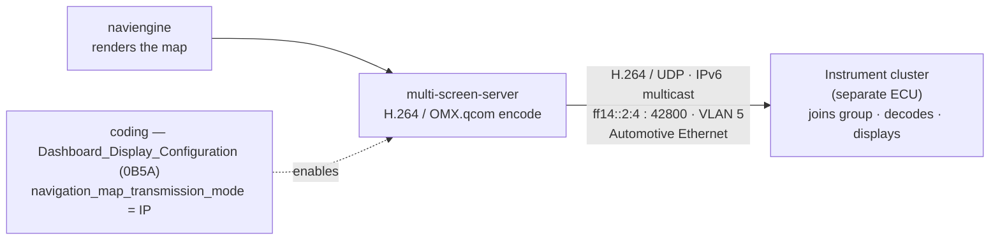
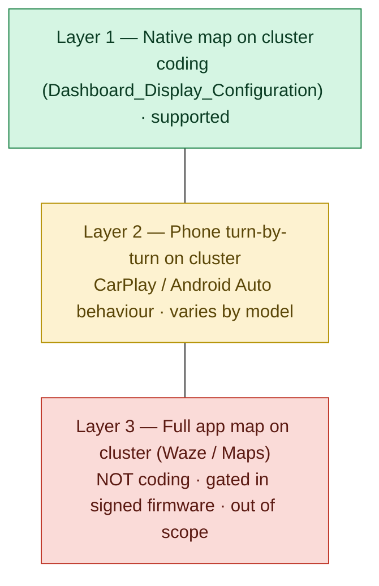

# The navigation-map-to-cluster pipeline (MIB3 MOI3 / LG)

How the native navigation map reaches the **instrument cluster** (the "Active Info
Display" / digital cockpit) on the **LG-built MOI3** variant of VW Group MIB3, and why the
three different ideas of "map on the cluster" are architecturally very different problems.

This is the core document of the repo. It is written as reverse-engineering / research
notes: every non-obvious claim carries a confidence tag so you can tell what was *measured*
from what was *inferred*. See [open-questions.md](open-questions.md) for the gaps and
[README](../README.md) for scope.

> **Scope reminder.** We document *that* the unit is protected by Qualcomm Secure Boot,
> dm-verity and VW firmware signing, and we describe where the relevant software gate sits.
> We do **not** describe how to defeat any of those protections — that is explicitly out of
> scope. Nothing here was written to a vehicle; all analysis is read-only, on our own copies
> of firmware and in a PC sandbox.

## Confidence tags

| Tag | Meaning |
|---|---|
| `[disasm]` | Verified by static reverse engineering (disassembly / decompilation of platform binaries). |
| `[runtime]` | Verified by executing real platform code in a PC sandbox (our own copies, no vehicle, read-only firmware image). |
| `[fw-static]` | Read directly from firmware files — config, shell scripts, systemd units, symbol tables — not executed. |
| `[inferred]` | Author inference from the above. |
| `[field]` | Community / forum / field report. |
| `[other-platform]` | Established on Harman MHI2 / MHI2Q or Audi MPR3 — **not** confirmed on MOI3 LG; shown only for contrast. |

Firmware generation referenced throughout: train `MOI3_EU_VW_R8030L` and neighbours, i.e.
MU **0803** (field unit), **0841**, **0883** (the copy most of the static/runtime work was
done on). HMI software versions seen: `H40.272.151` (MU 0803), `H40.272.304_OISmall2_EU`
(MU 0883). An official, signed update chain exists well past these (into the MU 19xx /
`R96x0L` range).

---

## 1. Overview — MOI3 LG renders, encodes and streams the map over IP



_At a glance: the head unit (`5F`) renders and H.264-encodes the native map, then streams it as IPv6-multicast video over Automotive Ethernet; the cluster is a **separate ECU** that joins the group and decodes. Coding (§4) selects the IP source. This is the **native** map — not the phone-app map (see §5–§6)._

On the LG MOI3 the map that appears on the cluster is **not** a signal wire from the head
unit to the cluster. The head unit **renders** the map, **encodes** it as **H.264**, and
**transmits** it as an **IP multicast video stream**. The cluster is a separate ECU that
**subscribes to the multicast group and decodes** the stream. `[disasm]` + `[fw-static]`

This is the decisive architectural difference from the Audi/MLB implementation of the same
feature. On Audi's "virtual cockpit", per the public Self-Study Programme (SSP 970893), the
navigation map and crossroad views go to the cluster `J285` over **LVDS**, and the menu/list
layer over **MOST**. On the **VW MQB LG** unit there is no LVDS map link and no MOST: the
Active Info Display map is **Ethernet video**. The two are not contradictory — they are
different transports chosen by different vendors/platforms. `[fw-static]` for the MOI3 path;
SSP 970893 for the Audi path (public PDF, linked in §9).

A behavioural tell consistent with "a video surface filling the map rectangle" rather than
"a native renderer drawing the arrow": when the cluster view is switched, the GPS arrow does
**not** re-centre the way a locally-drawn map would. `[field]` / `[inferred]`

One honest nuance up front: the hardware H.264 encoder and the AVB/Ethernet plumbing on this
unit **also** serve the camera system (surround/rear view). That the *same* encode-and-stream
path carries the cluster map is established by the navigation-side code and the adaptation
(below), not merely by "an H.264 encoder exists". The pieces that are specifically the
cluster-map path are called out as such.

---

## 2. The transport: `ff14::2:4`, UDP/42800, VLAN 5

| Property | Value | Evidence |
|---|---|---|
| Destination group | **`ff14::2:4`** (IPv6 multicast), full form `ff14:0000:0000:0000:0000:0000:0002:0004` | `[disasm]` single `ff14:` literal in the nav-SD `.so`; `[fw-static]` in route + firewall rules |
| Destination port | **42800** (immediate `mov w0,#0xa730`; `0xa730` = 42800) | `[disasm]`; the string `"42800"` does **not** exist in the binary → compiled, not configurable |
| Protocol | **UDP** | `[fw-static]` firewall rule `--dport 42800 -p udp` |
| VLAN / interface | **VLAN 5**, `eth0.5` | `[fw-static]` route install |
| Source | **the head unit itself** | `[fw-static]` source address in the rules is the unit's own `::73` |
| Container | **MPEG-TS** (PAT/PMT tables), via `sendto()` on a socket bound to `eth0.5` | `[fw-static]` strings / class names in the encoder |

Supporting detail, read directly from the firmware image (MU 0883):

- `/lge/app_ro/network/network` (the program that loads the packet-filter rules) contains,
  for both ingress and egress:
  `-s fd53:7cb8:383:3::73 -d ff14::2:4 -p udp --dport 42800 -j ACCEPT`, and the same pair for
  `fd53:7cb8:383:5::73`. The source address (`::73`) is the head unit's own address, which is
  what pins down "the head unit is the sender". `[fw-static]`
- `/lge/app_ro/ethernet/vlan-config.sh` (line 57) installs the group route onto VLAN 5:
  `ip -6 route add ff14::2:4 dev eth0.5 table local`; the head unit is `fd53:7cb8:383:5::73`
  on that VLAN. `[fw-static]`

Because the group address appears exactly once as a literal and the port is an immediate with
no backing string, **neither is a configurable setting** — they are compiled into the
navigation-SD library. The *enable* decision lives in coding (see §4), not in these literals.

The cluster-side **receiver** — the ECU that joins `ff14::2:4` and decodes — is a **different
ECU** whose firmware is **not** in these images (the head unit is diagnostic address `5F`; the
cluster is `17`). Everything in this document is the **producer** half. The real stream
parameters as seen by the receiver (negotiated resolution, fps, SPS/PPS) are an open question.

---

## 3. Components and roles

### 3.1 Map rendering — `naviengine` (the navigation engine)

- systemd unit **`naviengine.service`** runs `/lge/app_ro/navi/naviengine/runNavi.sh`; the
  actual executable is **`tsd.nav.mainapp.mib3`** (TSD core, Preh Car Connect; ~71 MB).
  `[fw-static]`
- It is the engine that **draws both maps**. Its `MapRendererConfig`
  (`etc/nav/standardConfig.cfg`) defines two rendering windows: **`mainunit`** (the radio
  screen, 800×480 in the `eu/single` package) and **`kombi`** (the cluster map, **1280×480,
  up to 12 fps**). `[fw-static]`
- It draws through `libEGL_adreno` / `libGLESv2_adreno` (OpenGL ES 3.0) onto a Wayland/IVI
  surface whose size and IVI id it requests over RSI from the display service. Which renderer feeds the `kombi` output is chosen by a **`_kombiMaprendererUri`** (a mode URI held in `libMIBNavSDClientLib`), and `FctVideoStreams` is exposed over BAP as available via **bit 58** — so the cluster's video *source* is selected by a URI/flag, not hard-wired. `[fw-static]`
- In the single-map package only one renderer is visible at a time (`ActiveSingleMapRenderer`,
  persisted): the map is **either** on the radio screen **or** on the cluster, not both. This
  is exactly what the "Map Switch" adaptation toggles (§4). `[fw-static]` + `[field]`
  (owners confirm the centre-screen map disappears when the map is on the cluster).

### 3.2 Video encode + transmit — `multi-screen-server`

`/lge/app_ro/graphics/multi-display/multi-screen-server`. This is the H.264 encoder and the
transmitter. It **does not render** — it only takes the finished frame of the engine's
`kombi` surface and ships it. Its command line — `multi-screen-server <ip> <port> <-m/-u> <surface ID to share> <fps>` — makes the **shared surface a parameter**: it ships *whatever* IVI surface id it is handed, not only the native engine's. That parametrisation is what the runtime route in §6 builds on. `[fw-static]`

- It is a Wayland client: it asks the compositor for the shared buffer of the engine's surface
  via the Weston **`ivi_share`** ("Buffer Sharing") extension — `get_ivi_share_surface(<id>)`,
  one buffer per frame (the `damage` event). If the extension is absent it logs
  `ERROR: ivi_share not supported` and exits. `[fw-static]`, `[runtime]` (it exits immediately
  in the sandbox, which has no `ivi_share`).
- The frame goes through a colour-convert shader (`multi-screen/encoder/Rgba2yuv.cpp`, RGBA→NV12;
  modes `--buf-gles-copy` default, `--buf-rgba2yuv`, `--buf-memcpy`, `--buf-usebuffer`), into
  the hardware encoder **`OMX.qcom.video.encoder.avc`** (H.264/AVC) using Qualcomm **ION**
  memory (`[omx_encoder]` log lines cite ION), then is packed into **MPEG-TS** (a
  `TransportStream` class with PAT/PMT) and sent by `sendto()` on the VLAN-5 socket. `[fw-static]`
- It opens `/dev/dri/renderD128` (GBM) and `/dev/ion`. Defaults in its help text: **4 Mbit/s**,
  keyframe period 4. Multicast vs unicast is selected by `-m Multicast` / `-u Unicast
  (disabled)`. `[fw-static]`

Because the encoder is hardware (Qualcomm OMX + ION), this half of the pipeline **cannot** run
on an ordinary PC — relevant to anyone trying to reproduce the stream off-vehicle.

### 3.3 Stream setup — VIWI / RSI and the nav-SD library

The stream is configured through the unit's internal **VIWI** (Volkswagen Infotainment Web
Interface) / **RSI** REST-over-JSON bus.

- **`us_displaymanagement::createOrUpdateStreamParameters`** (`@0x214814` in
  `libMIBNavSDClientLib_CarIF.so.00`, ~2.6 MB, namespace `Viwi::NavSd`) builds a **JSON** body
  and does an **HTTP POST** to the VIWI display-management microservice at a
  `displaymanagement/.../streamParameters` path. `[disasm]`
- Related symbols in the same library, confirmed present and located: `us_displaymanagement::
  NAV_KOMBI_STREAMPARAMETERS_NAME`, `DisplayManagementServiceHandler::ipStreamingEnabled()`,
  `FctVideoStreams::startup()` / `shutdown()`; strings `FctVideoStreams`,
  `_ipStreamingEnabled: 0x`, and framerate / "stream parameters" messages in the JSON path.
  `[fw-static]` (symbols) / `[disasm]` (the POST and the ip/port in `createOrUpdateStreamParameters`).
- The RSI bus itself: the firmware ships its **own service registry**
  (`MIB_ServiceRegistryApp-00`, port **443**) and an LG mock (`rsi-mockup`, port 7770) with 81
  specs under `/lge/app_ro/sai/spec/`; clients find services at `ws://127.0.0.1:443/api/v1/`.
  `[runtime]`. A useful open-source analogue of this bus is `wzr1337/rsi.server` +
  `wzr1337/rsi.serviceregistry`.
- The display service that owns displays / rendering surfaces / stream parameters is
  **`rsi-display-management`** (RSI `displaymanagement`, which is also the DSI
  `DSIDisplayManagement` service). It carries a `surfaces.map` naming `navi`, `test`,
  `navi-kombi-renderingsurface`. `[fw-static]`

### 3.4 The BAP function that wires map → cluster — `navsd_app`

`/lge/app_ro/carif/navsd_app` (built on the same `libMIBNavSDClientLib_CarIF`) is the **BAP
"NavSD"** function — the one that talks to the cluster. On startup it:

1. reads the cluster adaptation `MIB3_KEY_ADAPTION_DASHBOARD_DISPLAY_CONFIGURATION` (§4); then
2. creates, in `displaymanagement`, the elements **`navi-kombi-display`**,
   **`navi-kombi-renderingsurface`** and **`navi-kombi-streamparameters`** (destination
   `ff14:…:2:4`); binds the rendering surface to the engine's **`kombi`** renderer; and
3. **announces the stream to the cluster** over the BAP function **`VideoStreams`** (type,
   IPv6 address, UDP port, URI). `[fw-static]`

This is the crucial wiring: the thing fed into the multicast stream is the **native engine's
`kombi` surface** — see §6 for why that matters.

### 3.5 Startup order

In the vehicle the services come up as `vw-hmi` → `navi-al` → `naviengine` → (`navsd`,
`multi-display`, `rsi-display-management`). The systemd dependencies back this up:
`multi-display.service` (which runs `multi-screen-server`) is `After=naviengine.service`, and
`naviengine.service` is `After=navi-al.service`. `[fw-static]` The encoder is deliberately last
— it has nothing to ship until the engine is drawing.

### 3.6 Producer-side data flow

```
                   reads 0xB5A adaptation
  navsd_app  ───────────────────────────────►  rsi-display-management  (RSI displaymanagement)
     │  creates display / renderingSurface / streamParameters (dest ff14::2:4)   │
     │  binds the surface to the "kombi" renderer                                │ stream list
     ▼                                                                           ▼
  naviengine (tsd.nav.mainapp.mib3)                                      multi-screen-server
  draws the kombi map (1280×480) with                                    get_ivi_share_surface(id)
  libEGL_adreno / libGLESv2_adreno onto      ──►  Weston (ivi_share)  ──►  per-frame buffer →
  a Wayland/IVI surface                                                    RGBA→NV12 (Rgba2yuv) →
                                                                           H.264 (OMX.qcom, ION) →
                                                                           MPEG-TS → UDP sendto()
                                                                           on eth0.5 → ff14::2:4:42800
                                                                                    │
                                                 (announced to the cluster via BAP "VideoStreams")
                                                                                    ▼
                                                              cluster ECU (addr 17) — separate ECU,
                                                              joins the group and decodes (not in these images)
```

---

## 4. The coding that enables it — `Dashboard_Display_Configuration` / channel `0xB5A`

Turning the cluster map on is **coding/adaptation** — values a diagnostic tool (ODIS, and in
the community VCDS/OBDeleven) **reads and writes** on the head unit (`5F`). The group is
labelled **`Dashboard_Display_Configuration`** (internal name
`MIB3_KEY_ADAPTION_DASHBOARD_DISPLAY_CONFIGURATION`), **channel `0xB5A`**. These are standard
function-coding / adaptation values — no protection is involved in reading or writing them.

Fields (byte positions are within the adaptation's data block; bit 0 = least significant):

| Field (ODIS-style suffix) | Byte / bit | Meaning | Evidence |
|---|---|---|---|
| `navigation_map_transmission_mode` (`ID_NAVIGATION_MAP_TRANSMISSION_MODE`) | byte 0 | **0 = off, 1 = IP streaming, 2 = MOST, 3 = LVDS** — most likely the field that actually turns the cluster map on (§4.1) | `[fw-static]` (HMI field table); enable role `[inferred]` |
| `navigation_map_compression_mode` (`ID_NAVIGATION_MAP_COMPRESSION_MODE`) | byte 1 | codec selection (**H264**) | `[fw-static]` |
| `navigation_map_resolution` (`ID_NAVIGATION_MAP_RESOLUTION`) | byte 2 | requested cluster-map resolution index | `[fw-static]` |
| `ability_switch_nav_maps` (`ID_ABILITY_SWITCH_NAV_MAPS`, "Map Switch") | **byte 7 / bit 1** | `yes` = one map, switchable between radio screen and cluster; `no` = no switch (a Preh unit then shows a map on both screens); **not** what puts the map on the cluster (§4.1) | `[disasm]` + `[runtime]`; `[field]` |
| `crossroad_detail_map_transmission_mode` | (same group) | transport for the crossroad-detail view | `[fw-static]` (observed `off`) |

The same adaptation group also carries further "what else is pushed to the cluster" fields —
**cover art**, **call picture** and **station art** transmission — governing non-map artwork
sent to the cluster. Both units in §4.2 show them in this group (all three set to `bap`); their
byte positions are in [coding-model.md](coding-model.md) §5.1. `[field]` + `[fw-static]`

### 4.1 The Map Switch chain — and what it does *not* prove

The "Map Switch" bit is the one with a fully traced mechanism:

```
Dashboard_Display_Configuration  byte 7 / bit 1   (switchMapSupported)
        │   single store in the library
        ▼
   member 0x19a
        │
        ▼
   setBapEntity
        │
        ▼
   FunctionSupportActivationDeactivationOfTheVideoNavigationSupported
   (BAP NavigationSd FsgSetup  Df44 Bit0)
```

- `[disasm]`: there is exactly **one** instruction that writes member `0x19a`, from byte 7 /
  bit 1 of the adaptation, in the `nvmDataChanged` path — i.e. the mapping is unique.
- `[runtime]`: running the **real** `libMIBNavSDClientLib_CarIF.so` code in a sandbox process
  (no vehicle), forcing `0x19a = 1` makes the `Df44 Bit0` getter return 1, and `0x19a = 0`
  makes it return 0. The whole chain therefore holds both statically and at runtime.

> **Correction (2026-10-15).** An earlier version of this section concluded that this bit
> *is* the native cluster map ("`VideoNavigation` is the `Df44 Bit0` feature, enabled by
> byte 7 / bit 1"). That over-read the evidence. The full name of the BAP flag, as it appears
> in the library's symbols, is
> `FsgSetup::…FunctionSupportActivationDeactivationOfTheVideoNavigationSupportedDf44Bit0`: it
> tells the cluster that the head unit supports **switching the video map on and off**, not
> that the video map exists. That matches the field's own name (`ability_switch_nav_maps`)
> and a field report: a Preh / JOYNEXT unit shows the native map on the cluster with this bit
> at `no` (§4.2, reported by [@Mjukes](https://github.com/Mjukes) in
> [issue #1](https://github.com/lipedesign/mib3-moi3-lg-research/issues/1)). `[disasm]` +
> `[field]`

**Field test** (same unit, same issue): the owner toggled the bit. With `no`, the map is on both
screens at once and the navigation settings have no switch option. Set to `yes`, a Switch button
appears and the factory map is on one screen at a time, with a compass on the other. `[field]`

**What actually turns the map on** is then most likely `navigation_map_transmission_mode`
(byte 0): its values are the transports themselves (off / IP / MOST / LVDS), both units in §4.2
show the map on the cluster with it at `IP_streaming`, and the library carries an
`ipStreamingEnabled` flag on the stream path (§3.3). The link from byte 0 to that flag has
**not** been traced in the disassembly yet — see [open-questions.md](open-questions.md).
`[inferred]`

Other coding the software reads along the way: `_iaa_function_coding`, `_pso_function_coding`,
`SemidynamicRouteGuidanceAvailable`, `FunctionList` — all ordinary function-coding /
function-list, the things the diagnostic tool reads and writes. `[disasm]`

### 4.2 What a real unit reads as

Two in-service units have been read with a diagnostic tool so far: an LG unit (the MU 0803
field unit) and a Preh / JOYNEXT unit in a 2020 GTE, UK market car (reported in
[issue #1](https://github.com/lipedesign/mib3-moi3-lg-research/issues/1)). Both show the native
map on the cluster, and both read the same ten fields in the same order:

| Field | LG — `MOI3_EU_VW_R8030L` (MU 0803) | Preh / JOYNEXT — `MOI3_EU_VWMQB_P33000P` (MU 0330) `[field]` |
|---|---|---|
| `navigation_map_transmission_mode` | **IP_streaming** (byte 0 = 1) | **IP_streaming** |
| `navigation_map_compression_mode` | **H264** (byte 1) | **H264** |
| `navigation_map_resolution` | 1 (byte 2) | 1 |
| `crossroad_detail_map_transmission_mode` | off | off |
| `crossroad_detail_map_resolution` | 0 | 0 |
| `coverart` | bap | bap |
| `ability_switch_nav_maps` | **yes** (byte 7 / bit 1) | **no** |
| `dynamic_icon` | off | off |
| `call_picture` | bap | bap |
| `stationart` | bap | bap |

The only difference is the Map Switch bit — which is what exposed the correction in §4.1. On
the LG unit (`yes`) the map *moves*: it leaves the radio screen while it is on the cluster
(§3.1). On the Preh unit, `no` gives a map on both screens at once (field test in §4.1).

On LG, whether two maps can be shown at all is also decided by **hardware**. The navigation
engine ships as two packages, `SingleMap` (one visible renderer) and `DualMap` (two), and
`/lge/app_ro/post_init/data/navigation.sh` links one of them at first boot from a board strap,
`/sys/devices/soc/soc:common_gpio_default/grade_id` (`0x0` = single, `0x1` = dual) — not from
coding. `[fw-static]` What `no` does on a single-grade LG unit is an open question.

On the LG side, the reading is exactly what the firmware shows independently (`ff14::2:4`, `multi-screen-server`
H.264/OMX.qcom): the native cluster map leaves the head unit as **H.264-over-IP**. A companion
networking adaptation (`Switching_Networking = Ethernet`) is seen alongside it, consistent with
the Ethernet transport. Public Ross-Tech forum threads show the field across units — one at
`IP_streaming`, another at `OFF` — confirming it is a real, market-dependent coding value, not
a fixed one. (No vehicle is identified here; contributors reading their own units are asked to
report model/market/MU — see [open-questions.md](open-questions.md).)

---

## 5. The three "layers" of map-on-cluster



These are routinely conflated; they are three different problems.

| Layer | What it is | On MOI3 LG | Protection wall? |
|---|---|---|---|
| **1. Native map** | the built-in navigation map drawn by the head unit's own engine and streamed to the cluster (`ff14::2:4`, announced over BAP `VideoStreams`) | **coding** — supported, normally active; selected by the `0xB5A` adaptation (§4) | No |
| **2. Phone turn-by-turn** | maneuver arrows / next-turn from the phone's navigation, shown on the cluster via CarPlay / Android Auto | **CarPlay's own behaviour**, varies by model/firmware (see below) | No (behaviour, not coding) |
| **3. Full app map** | the Waze / Google Maps / Apple Maps **map itself**, rendered as video on the cluster | **not coding** (§6); a public *runtime* PoC exists (§6 update) | **Yes — access, not firmware** |

Layer 2 detail `[field]`: multiple MIB3 owners report that **phone turn-by-turn directions do
rise to the cluster** — **consistently with Apple Maps over CarPlay**, while reports for
**Google Maps / Android Auto diverge**. One data point on the Google side: the owner of a
Preh / JOYNEXT unit (MU 0330, iPhone) reports arrows from **both Apple Maps and Google Maps**
on the cluster ([issue #1](https://github.com/lipedesign/mib3-moi3-lg-research/issues/1)).
This looks like **factory CarPlay behaviour**, not a coding item. The firmware backs this up: `libMIBNavSDClientLib` carries an `AppConnectRouteGuidanceActiveServiceHandler` and a BAP `FctSemidynamicRouteGuidanceAvailable` (**bit 50**) with a `SemidynamicRouteGuidance` data class (ETA, time-to-destination) — the head unit natively takes the phone's route guidance and forwards it to the cluster as *data* (arrows / ETA), a lighter path than layer 3's full video. `[fw-static]` (The MIB2-era `overall.nds` swap trick that forced more onto the cluster was
**closed on MIB3**.) This is the cheap, no-tools thing to verify across cars — please do and
report (model, market, MU, which app).

---

## 6. Why layer 3 (full app map) is **not** coding — the architecture

Two independent architectural facts make the full phone-app map on the cluster a
**firmware-modification** problem, not an adaptation:

1. **A hardcoded software gate.** The relevant gate,
   **`RouteGuidanceByMobileDevice`** (pushed via `setBapEntity`, BAP `Df47` Bit3/4/5), is set
   to **`false` in the binary** on the builds analysed, and it is **not exposed as an
   adaptation channel** anywhere. There is no `0xB5A`-style value a diagnostic tool can flip;
   the decision is compiled in. `[disasm]` (the hardcoded `false` and the absence of a backing
   adaptation were both read in the decompiled gate).
2. **The stream source is the native engine, not the phone.** The thing bound to the
   `ff14::2:4` stream is the engine's **`kombi`** rendering surface (§3.4). Even if the gate
   were flipped, the multicast would still carry the **native** map, because `navsd_app` wires
   the native renderer — not the CarPlay surface — into the stream. Putting the *app's* map on
   the cluster therefore requires **both** changing the gate **and** replacing the stream
   source.

Both of those are changes to **signed firmware**. The LG MOI3 accepts only firmware signed by
VW; the signing key is not on the unit. The software *location* of the gate is mapped (above),
but **producing or operationalising a bypass of the signature/secure-boot chain is explicitly
out of scope for this repository**, and we do not publish patch offsets or steps aimed at
defeating those protections.

> **Update (Oct 2026) — a runtime route exists, shown publicly.** The two facts above rule out *coding*, and they show that the **native** route (flip the gate **and** re-point `navsd_app`) would mean signed-firmware changes. They do **not** rule out a **third route**: a **custom service running at runtime** that takes the phone-app surface (CarPlay / Android Auto), crops it to the cluster's **1280×480**, and pushes it over the same **RSI / display** path — **without touching the signed firmware** (it runs from `tmpfs`; a reboot clears it, and dm-verity / Secure Boot / the VW signature stay intact). A public proof-of-concept by **daChillout & Meich** on a Cupra Formentor VZ (MOI3) did exactly this — Android Auto (Waze / Google Maps) on the cluster — and the author says it will be open-sourced ([drive2.ru](https://www.drive2.ru/l/745563717583775343/)). It **validates** the pipeline above: RSI, `multi-screen-server` and the 1280×480 cluster stream are exactly what it uses. **What the PoC does not publish — and what this repo does not cover — is how code execution is obtained on the unit.** The *display* step (a runtime RSI service) defeats no protection; the *access* to run code on the ECU is the separate, out-of-scope part.

### 6.1 The protection layers (described, not defeated)

The unit is protected by, at minimum:

- **Qualcomm Secure Boot** (the SoC boot chain),
- **dm-verity** (integrity of the read-only root/system),
- **VW firmware signing** (the update container must be signed by VW; the private key never
  leaves VW's infrastructure), and
- **SMACK** (the AGL/Linux mandatory-access-control layer).

Documenting that these exist and how the system is assembled is in scope. **Bypassing them is
not** — see the repo scope and [open-questions.md](open-questions.md). This keeps the project a
reference, not a brick/piracy guide.

### 6.2 What the sandbox work does and does not show

Much of the `[runtime]` evidence above comes from running **our own copies** of platform
binaries in a PC sandbox (Linux AArch64 container, firmware image mounted **read-only**). That
work proved the coding chain of §4.1 dynamically, and brought the HMI + nav engine up far
enough to see the service wiring. It deliberately **never touched** Secure Boot, dm-verity or
the signature chain, and **never wrote to a vehicle**. It also hits a hard limit for
reproducing the *video*: the encoder is Qualcomm hardware (OMX + ION), so the real stream
cannot be produced on a PC — the sandbox can only study the control path, not emit the H.264.

---

## 7. The public landscape — and why it doesn't carry over

The active public scene for "CarPlay / phone map in the Virtual Cockpit" is **entirely on the
Harman MHI2 / MHI2Q platform** (and Porsche MH2P). That platform is **MOST bus + QNX + Tegra**,
with an **open MIB2-family head unit** (Java-hookable, SSH-rootable). **None of it transfers to
MOI3 LG**, which is **Ethernet + AGL/Linux + Qualcomm**, signed and locked (SMACK), with the
cluster video going over **IP multicast**, not MOST. `[other-platform]`

Concretely, the Harman method is *CarPlay Auxiliary/ScreenAlt → H.264 → MPEG-TS → **MOST150** →
Virtual Cockpit* and it relies on rooting the open MIB2 head unit. On MOI3 LG there is no MOST,
no QNX, no Tegra, a different CarPlay stack, and no public root. The scene's own leads have said
as much — that the MOI3 units are "completely different from MIB2" with root access uncertain.

Public examples of that **other** platform (shown for contrast, not as something to port):

| Repo | Platform | What it does |
|---|---|---|
| `harman-f/mhi2_altscreen_carplay` | MHI2 (Harman/QNX/Tegra) | Waze/Google/Apple Maps as video in the Virtual Cockpit over MOST; README warns it is not a USB package, needs pre-existing SSH, can brick the unit |
| `yuedizhibo/MHI2Q-CarPlay-AltScreen` | MHI2Q (Audi) | CarPlay alt-screen to the cluster |
| `Lanye-z/MHI2Q-CarPlay-MMI-Mirror` | MHI2Q (Audi) | MMI/CarPlay mirror to the cluster |
| `luka-dev/mib2q-carplay-rgi` | MHI2Q (Audi) | 3D maneuver arrow over the cluster map |
| `kamgurgul/mib2q-carplay`, `chefranov/mhi2-au37x-carplay` | MHI2 / MHI2Q | CarPlay on the cluster |
| `Mr-MIBonk/M.I.B._More-Incredible-Bash` | MIB2.x (Harman) | general MIB2 toolkit |
| `OneB1t/VcMOSTRenderMqb` | MIB2 (QNX/MOST) | write data / a VNC stream to the MQB Virtual Cockpit; requires MIB2 + SSH |
| `fifthBro/mh2p-cluster` | Porsche PCM5 / MH2P | Maps/Waze to the cluster (beta) |
| `MacsInSpace/mhi2-android-auto-cluster-map` | Harman "Discover Pro" MIB2.5 High | Android Auto map on the cluster via SD card |
| `Squallman/mpr3-carplay-vc` | **MIB3 MPR3 (Audi Premium)** | RE prototype, offline/mocked, "not deployment ready" — closest *architecture*, still not LG |

**For MIB3 LG (MOI3) specifically, the public tooling is appearance / data / forensics only —
nothing touches navigation or the cluster:**

- `n3oka/*` — the most advanced LG author: boot-screen simulator, `.MCF` 3D viewer, image
  resolver, MQB-evo and camera (`2Q0`/`5WA`) dataset editors. All of it edits files on a PC;
  the boot-screen tool states outright that it **"never writes to the unit."**
- `jilleb/mib3-toolbox` — a small file-format RE repo (boot-animation extractor, `.gca` / `.mcf`
  / `.ops` 010-Editor templates). No function install, no nav, no cluster.
- `nicolasnt3-a11y/MIB3tosaurus` — forensics (parses coredumps/logs, plots stored GPS on a map).
  Not vehicle navigation.

These confirm, from the public side, what §6 argues from the architecture: the native map (layer
1) is coding and already works; the full app map (layer 3) has no public, non-firmware path on
MOI3 LG.

---

## 8. Platform-vs-platform summary (don't mix these up)

| Fact | Platform | Applies to MOI3 LG? |
|---|---|---|
| `ff14::2:4` / UDP 42800 / VLAN 5, `createOrUpdateStreamParameters`, VIWI POST, H.264/OMX.qcom | **MOI3 (MIB3 LG, AGL/AArch64)** | **Yes** — this is the platform under study |
| `Dashboard_Display_Configuration` `0xB5A`; Map Switch → BAP `Df44 Bit0` (on/off-switch support, §4.1) | **MOI3** | **Yes** — static + dynamic (same field names read on a Preh / JOYNEXT unit, `[field]`) |
| `setActiveDisplayable`, numbered displayables (26/29/40/42/60/93) | **MPR3 (Audi)** | Reference only — analogous architecture, **not** confirmed literals on LG |
| MOST150, `isoTX2`, type-111 / AltScreen, MOST contexts | **MHI2 / MHI2Q (QNX)** | **No** — different transport/method; absent on MOI3 |
| Map/crossroads to cluster over **LVDS**, menus over **MOST** | **Audi/MLB** (SSP 970893) | **No** — MOI3 LG uses IP video instead |

Rule of thumb: **MOI3 transport = IP multicast; MHI2 = MOST; Audi virtual cockpit = LVDS+MOST.**
Displayable numbers and `setActiveDisplayable` are Audi (MPR3), not LG.

---

## 9. Public references

- **SSP 970893 — "Third-generation modular infotainment matrix"** (VW/Audi Self-Study
  Programme; public via US NHTSA). MIB3 architecture: head unit `J794`, cluster `J285`,
  Basic/High/Premium (Basic lacks LVDS), GPS received by `J949` and sent to `J794` over
  Ethernet, and the Audi LVDS+MOST cluster path (contrast to the MOI3 IP path).
  <https://static.nhtsa.gov/odi/tsbs/2021/MC-10189329-0001.pdf>
- **Black Hat EU-24 — "Over-the-Air: Compromise of Modern Volkswagen Group Vehicles"**
  (PCAutomotive). Confirms VW sources MIB3 from **three vendors — Preh Car Connect, LG, Aptiv**
  — and that the published security research targets the **Preh** unit (Renesas R-Car M3), not
  LG; useful context for why LG is under-documented.
  <https://i.blackhat.com/EU-24/Presentations/EU-24-Parnishchev-OverTheAirVW.pdf> ·
  advisory: <https://pcacybersecurity.com/resources/advisory/vulnerabilities-in-vw-mib3-infotainment-2>
- **RSI / VIWI bus (open-source analogue):** `wzr1337/rsi.server`, `wzr1337/rsi.serviceregistry`.
- **Harman MHI2 contrast (other platform):** `harman-f/mhi2_altscreen_carplay` and the repos in
  §7.
- **Ross-Tech forum** threads documenting `Dashboard_Display_Configuration` values across units
  (`navigation_map_transmission_mode` = `IP_streaming` vs `OFF`).

---

*Method note.* Findings tagged `[disasm]` / `[fw-static]` come from reading firmware and
disassembly/decompilation of platform binaries; `[runtime]` from executing our own copies in a
read-only PC sandbox with no vehicle attached. Nothing here was written to a car, and nothing
here touches Secure Boot, dm-verity or the VW signature chain. Corrections and cross-car
verifications are very welcome — see [open-questions.md](open-questions.md).
