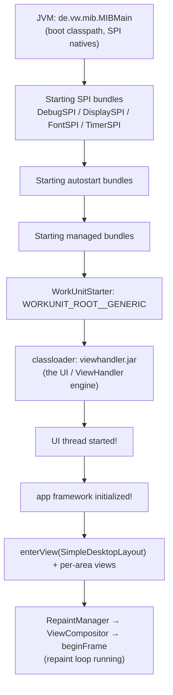
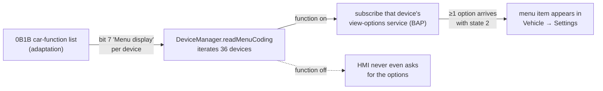

# The HMI from the inside — MIB3 "MOI3" (LG)

This document is about the **user interface of the LG-built MOI3 head unit**: what the HMI
*is* as a running program, how it starts, how it draws a screen, which internal buses it
talks to, and — the part that matters most for coding — **how it decides what to show**.
The focus throughout is the **mechanism** of the platform, not any one car's values.

Where [architecture.md](architecture.md) places the head unit in the vehicle and
[firmware.md](firmware.md) describes the firmware package, this page opens the HMI process
itself. The coding/adaptation **fields** it reads are catalogued in
[coding-model.md](coding-model.md); the read-only PC method that produced most of the
runtime observations here is [bench-emulation.md](bench-emulation.md); the navigation path
to the second screen is [cluster-map.md](cluster-map.md).

> **Read-only, no vehicle data.** Everything below is analysis of a public firmware package
> plus observation of the HMI **running on a PC bench**. Nothing was read from, or written
> to, a vehicle; no VIN, serial, part number or any single car's coding appears here. The
> unit enforces Secure Boot, dm-verity and a signed update package (see
> [firmware.md](firmware.md) §6); those are named as architectural facts and **defeating
> them is out of scope**. Nothing here is a unit modification.

---

## Confidence convention

The same tags used elsewhere in this repository:

| Tag | Meaning |
|---|---|
| **[verified]** | Observed in execution on the read-only bench (the HMI actually did this), or read directly from the firmware's own files. |
| **[static]** | Read from decompiled bytecode / native code, but not exercised in a run. |
| **[inferred]** | A deduction from the above, or general toolkit knowledge — treat as a lead, not a fact. |

Decompilation was done with a public Java decompiler (CFR) and a public RE suite (Ghidra);
bytecode was cross-checked with the `javap` shipped inside the firmware's own JVM. No
proprietary code, strings or assets are reproduced here — components are **named and
described**, not pasted.

---

## 1. What the HMI *is* — a Java/OSGi application rendering through OpenGL ES

The running MOI3 interface is **not** a native C++ GUI. It is a **Java application on
OpenJDK 8** (a Zulu aarch64 build, `1.8.0_242`), structured as an **OSGi** bundle
framework, rendering through **OpenGL ES** onto a **Weston/Wayland** compositor. This is
the MIB2 HMI lineage re-hosted on Automotive Grade Linux instead of QNX. **[verified]**

### 1.1 The code

The HMI code lives in two places in the firmware (see [firmware.md](firmware.md) §5 for the
package view):

- **`/lge/hmi`** — the LG-supplied base: the bundled `jvm/`, and `jar/` with the DSI/SPI
  layer. The large jar is **`MIBHMI-DSI.jar`** (~23 MB, **≈13,884 classes** under
  `com/lge/mib3oi`), the LG implementation of the device-service bus and its protobuf
  message classes. Alongside it: **`MIBHMI-SPI.jar`** (the hardware service-provider
  interfaces), **`jopengl_es3.jar`** / **`jopenglnw_es3.jar`** (the OpenGL-from-Java
  bridge), `protobuf-java`, `ObjectSwapper.jar` (a reader for the firmware's own binary
  resource format), and a debug/logging jar. **[verified]**
- **`/vw/hmi`** — the VW application and skin partition: the application jar
  (`MIBHMI-STD-…-bin.jar`, ~63 MB), the UI toolkit (`S3DK-Core.jar`), an embedded HTTP /
  WebSocket / OSGi runtime (Jetty + OSGi libs), `config/`, and the **skins** under
  `Resources/skin0|1|4|5`. The variant is **`OISmall2_EU`** (the small-display skin; its
  canvas is **800×480** — see §2.4). **[verified]**

The native side (`/lge/hmi/libs`) is thin and purpose-built: the OpenGL JNI bridge
(`libjopengl_es3.so`), a Wayland native-window helper (`libjopenglnw_es3.so`), the DSI
transport (`libDSIService.so`), image/font loaders, and small SPI natives (display, font,
timer, debug). **[verified]**

### 1.2 OSGi, SPI and the bundle model

The HMI is assembled from **OSGi bundles**. Three classes of bundle come up in order (§2.2):

- **SPI bundles** — the *Service Provider Interface* layer: thin Java wrappers over the
  native platform services (debug log sink, **display**, **font**, **timer**). Each is
  backed by a small native `.so` and a JNI entry point; e.g. the display SPI
  (`com.lge.mib3oi.spi.display.DisplaySPIImpl`) is the piece that decides the screen
  resolution (§2.4). **[verified]**
- **autostart bundles** — framework services that must run before the UI.
- **managed bundles** — the application domains (system, user management, radio, media,
  phone, sound, car, navigation, …) that own screens.

OSGi is why the HMI can run **degraded**: a domain whose backing service never shows up is
simply a bundle with nothing to talk to, and the HMI substitutes a placeholder for it
rather than failing (the `GenericDomain` app — §3.4). **[verified]**

### 1.3 The rendering stack

```
Java UI (S3DK widgets, viewhandler.jar)
   │  enqueues GL commands
   ▼
jopengl_es3.jar ── JNI ──► libjopengl_es3.so   (command-stream executor; Flusher.flushImpl)
                                    │  NEEDED
                                    ▼
                         libEGL_adreno.so / libGLESv2_adreno.so   (Qualcomm Adreno)
                                    │   DRM "msm" (not kgsl) → /dev/dri/card0, /dev/ion
                                    ▼
                         Weston/Wayland 1.9.0  (ivi-shell; SDE DRM backend; outputs DSI-1, HDMI-A-1)
```

Facts worth keeping straight:

- The GL bridge binds the **whole OpenGL ES 3.2 core** (357 GL + 44 EGL entry points, no
  vendor-suffixed extensions). With the firmware's own launch line the HMI actually
  **requests only an ES 2.0 context** and a pbuffer surface, and a measured run used ~62
  distinct GL/EGL calls (`glVertexAttribPointer`, `glUniformMatrix4fv`, `glDrawArrays`,
  texture binds, plus program-binary caching). An ES 3.1 path exists but is only taken with
  an explicit `-D…graphics.gles.v3` flag. **[verified]**
- The GL binding is a **command stream**, not direct calls: the Java side enqueues commands
  into sized ring buffers (`-Dopengles.cq.*`), and a native executor (`libjopengl_es3`,
  `Flusher.flushImpl`, internally `invoke_*`) replays them against the driver and returns
  results back through the buffer. This is why the renderer is built for a real GPU: results
  like `glGetString` round-trip through the command buffer. **[static]/[verified]**
- The GPU path goes through the Qualcomm **Adreno** user driver over the **DRM `msm`**
  kernel interface (the kernel has `CONFIG_QCOM_KGSL` **off**; the device-tree node is still
  named `kgsl-3d0`, which is where the old "kgsl" description came from). There is **no
  software-render fallback** in the firmware. **[verified]**

> On the bench the two Adreno libraries are replaced by a forwarder so a software GL on the
> host can draw the frames read-only; that technique, and why a genuinely rendered cockpit
> needs the real GPU, is in [bench-emulation.md](bench-emulation.md) §4 and §6. The GPU is
> **not** modified — it is simply absent on a PC.

---

## 2. Startup — how the HMI comes up

### 2.1 How the unit launches it

On the car the HMI is a **systemd notify service** (`vw-hmi.service`, `WatchdogSec=1min`,
`FailureAction=reboot-immediate`) → `hmiroot.sh` (sets `XDG_RUNTIME_DIR` under Weston,
pre-loads a few natives) → `runHMI.sh`, which assembles the JVM command line: a boot
classpath of the `/vw` and `/lge` jars, a 128 MB heap, an Azul class-preload archive, and
graphics flags (the GL command-queue sizes, eager gfx init, and a shader-binary cache
directory). **[verified]** The UI entry point is `de.vw.mib.MIBMain`. **[verified]**

### 2.2 The bring-up order (observed in the logs)



This exact sequence — **SPI → autostart → managed → work units → ViewHandler → UI thread →
app framework → views → repaint loop** — was observed end to end on the bench. **[verified]**
The RSI status line goes live around the ViewHandler step (it reports the skin, an
`hmisoftware.version` of the form `H40.*_OISmall2_EU`, `protocol.version:=1.2`, a generic
`vehicle.id`, open-subscription and free-memory counters). **[verified]**

### 2.3 Work units and the startup timeout

The HMI starts in **"work units"** (`ContextInformationWorkUnit`, `WORKUNIT_*`). A unit that
needs a service waits for it; the default wait is **15000 ms** each, from two HMI properties
(`de.vw.mib.asl.startup.timeout.dsi` and `…timeout.rsi`). On the bench, with many services
deliberately absent, the full start took minutes; dropping the timeout to ~2 s brought it to
~60 s **and produced the exact same list of "missing" services** — i.e. the timeout governs
*how long it waits*, not *what it needs*. A commented `taskPoolCount` property would
parallelise the units. **[verified]** Feature availability is also gated at this stage by
**feature flags** read from the configuration (see §6.6). **[verified]**

### 2.4 Resolution → skin selection

Before it has a window, the display SPI (`DisplaySPIImpl`) reads a single board file
(`…/display_id`) whose third byte selects a resolution: `'2'`→1280×640, `'3'`→1560×700, and
**anything else → 800×480**. With the resolution it builds the Wayland-IVI native renderer
and registers it as the EGL default display. The **OISmall** skin is authored for the
800×480 case (its `info.txt`: `skin.displayname=VW_OI8_Skin_Core`, canvas 800×480,
`SkinBrand=2`). Without the board file the HMI runs **windowless**, taking the size the
display *service* reports instead. **[verified]**

### 2.5 Where the HMI sits among the system services

The HMI is a **client**. The processes it depends on — all native C++ daemons on the car,
each reachable over the internal transport — include:

| Daemon | Provides to the HMI |
|---|---|
| `persistence-app` | persistence (user prefs, stored state), and the diagnosis/coding RDID store (§6.1) |
| `mcu-interpreter` | power-management + clamp (ignition) state (§2.6) |
| `touch-app` | the key-panel / touch input service, and the sound **controls** (§4, §6.5) |
| `carifservice` (domain 16) | the vehicle-state (BAP) services — translates the car bus to the HMI (§5) |
| `radio-hmi` + `radio` | the tuner domain (§6.5) |
| `audiomgnt` | the RSI `audiomanagement` service — sound settings, volume, mute (§6.5) |
| `displaymgr`, `multi-screen-server`, `rsi-display-management` | the Weston-backed display-management + the map-video encoder |
| `naviengine`, `navi-al` | the navigation engine and its abstraction layer |

The HMI's own bring-up (§2.2) interleaves with these: it subscribes to power, display,
persistence and key-panel early, and to the car/radio/media/phone/sound domains as each
announces itself. The **producer-side** startup order for the map path
(`navi-al` → `naviengine` → `multi-screen-server` / display management) is documented in
[cluster-map.md](cluster-map.md) §3.5; one detail relevant here is that `navi-al`
(`KipcProvider::procDiagMsg`) only accepts the coding/adaptation stream when the message
header marks the right diagnosis service — i.e. several independent consumers read the same
startup data stream (§6.1). **[static]**

### 2.6 Turning the screen on

The main area stays in `HMI_USER_PERCEIVED_OFF` until the HMI receives a valid
`powerManagementState` from the MCU-interpreter domain. The mapping it applies
(`AslTargetSystemPowerManagementHandling`): states `ON/ON_DIAG/ON_TEL` → screen on;
`ON_SWDL` → on, software-update; `STANDBY*` → conditional; `STANDBY_RESTRICTED`/`OFF` →
off; and the update only counts with the message's `validFlag = 1`. (The power service
encodes its integers as zig-zag `sint32`, unlike the plain `int32` of the display and
key-panel services — a framing detail that matters when reading the bus.) **[verified]**

---

## 3. Screen composition — how the HMI draws

### 3.1 Screen areas and content

The screen is divided into named **areas**, and the HMI's content processor assigns a
*content id* to each area. Observed areas and the content the composer placed in them:

| Screen area | Example content |
|---|---|
| `ScreenAreaStage` | the main stage — `HMI_RADIO`, `HMI_GRIDMENU`, `HMI_CAR`, … (or `HMI_USER_PERCEIVED_OFF`) |
| `ScreenAreaControlCenter` | `HMI_CONTROLCENTER` |
| `ScreenAreaStatusBar…` | the status bar |
| `ScreenAreaMenuBar…` | the menu bar |
| `ScreenAreaParticleBackground` | `HMI_BACKGROUND` |
| `ScreenAreaDigitalAssistant` | the assistant / welcome overlays |
| `ScreenAreaPopup` | pop-ups (full-screen area, §7) |

Content is routed by `ContentProcessorManagerImpl` / `StageContentProcessor.doRequestContent`:
a hard key, a touch, or an internal event asks for a content id, and the processor enters the
matching **view** in the right area. **[verified]**

### 3.2 Views and the skin

A **view** is a generated class (e.g. `SimpleDesktopLayout`, `SYSTEM_CONTROLCENTER_MAIN`,
`GENERIC_DOMAIN_FEATURE_NOT_AVAILABLE`, the navigation wait-screen, the welcome overlay).
The visual definition — layout, margins, images, animations, colours — lives in the **skin**,
not in the application logic:

- Each skin (`Resources/skin0|1|4|5`) carries a large image container (`images.mcf`, ~185 MB
  on `skin0`), an `info.txt` (brand, display name, canvas size), a colour map
  (`ambienceColorMap.res`), and a **`viewhandler.jar`**. **[verified]**
- `viewhandler.jar` holds **generated view classes** (names like `Sdl__0` for the desktop
  layout, `Psapni__0` for a system pop-up) that feed concrete geometry and animation
  parameters to the widgets, pulling the literal values from a **`SkinLiteralPool`** in the
  same jar. **[static]** These numbers are fixed skin data: they do **not** depend on the
  announced screen size, the display, or the coding. **[verified]**
- The skin assets are the compiled output of an authoring toolchain (a "skin editor"
  producing a "skin master" for the S3D toolkit); the repository only ever reads the
  **compiled** result in the firmware, so that tool naming is **[inferred]**.

### 3.3 Widgets and the repaint loop

The UI toolkit is a widget tree: `AbstractWidget` → `Container` → `View` / `PopupView`,
with `TextArea` and image widgets (`Image`, `ScaleImage`) and a `LayoutAttribs` record
(insets, gap, orientation, alignment, baseline offset) on each. Drawing is event-driven:
`RepaintManagerImpl.consumeEvent` → `RepaintEventImpl` → `ViewCompositorImpl.repaintViews`
→ `beginFrame`. **The HMI only paints when something changes** — a run that reaches a stable
screen simply stops emitting frames. **[verified]**

Backgrounds (and pop-up frames) are drawn by a `BackgroundCompositor`; the "simple" mode
(`paintSimple`) stretches one skin image over a computed area, honouring the image's fixed
(non-stretching) borders. **[static]** The per-widget tree (positions, sizes, insets) was
read **non-destructively** from the running HMI through the Java debug interface (JDWP/JDI,
using the firmware's own debug agent) — it reads object fields only, changes nothing.
**[verified]**

---

## 4. The internal buses the HMI consumes — DSI and VIWI/RSI

The HMI speaks two distinct internal buses. Knowing which one a domain uses is the first
step to understanding why a screen is or isn't available.

### 4.1 DSI — the device-service bus (protobuf over the LG transport)

The HMI is a **client of ~50 DSI services** (`org.dsi.ifc.*`), each carrying **protobuf**
messages. The DSI surface is its view of the platform and the car: display management, power
management, persistence, key panel, Bluetooth / phone / address-book, radio/tuner, media, the
`DSICar*` vehicle-state family, search, and more. **[static]** Transport is the LG **kipc**
IPC (device nodes `/dev/csr` / `/dev/css`, an LG kernel driver on no public kernel); on the
car these daemons ultimately reach the MCU and CAN. **[verified]**

Message shape (as framed on the bus, described not dumped): a **channel** (the sender's
domain / PID), an **interface id**, an **instance id**, an **api id**, then the protobuf
body. Conventions observed: **[verified]**

- **The channel identifies the sender.** The HMI sends everything with its own
  `PID_DSI_SERVICE` channel; the destination is the interface. Daemons answer on their own
  channel.
- **Request and response use neighbouring interface ids** (e.g. display 100→101, power
  1100→1101, persistence 1400→1401, key panel 300→301). **Interface 9000 is the service
  announcement** ("WELCOME").
- A reply is accepted **only against a pending request** — an unsolicited push is discarded
  as "unexpected".
- `validFlag ∈ {0 unknown, 1 valid, 2 invalid}` on every attribute update.
- Integer encoding varies per domain (plain `int32` for display/key-panel, zig-zag `sint32`
  for power and for the car-state services) — a real framing difference, not cosmetic.

**Input** rides DSI too, on `DSIKeyPanel` (domain `0x80000000000`, requests if 300, events
if 301): `updateKey2` (api 25: keyboard, key, state, time, valid — state 1 press, 0 release,
3 long-press), `updateGesture2` (api 20: an already-recognised gesture with x/y, not raw
points), and `updateEncoder2` (api 23: the rotary knobs, signed increment). The HMI does not
accept any key — it consults a key table (§6.6). **[verified]**

### 4.2 VIWI / RSI — the local REST/JSON service bus

A second, higher-level bus: **RSI** (a VIWI-style REST/JSON service layer), used for
user-facing *data* services. The HMI discovers them through a **service registry** over
WebSocket. **[verified]** The firmware ships the whole surface:

- the **service registry** app the HMI looks for (it listens on **port 443**, which is where
  the HMI connects — `ws://127.0.0.1:443/api/v1/` — plus a few auxiliary ports);
- an **LG-provided RSI mock** (loopback, its own port) with a service list;
- **~80–81 service specifications** (`viwi.service.<name>-<version>.json`: resources, fields,
  operations) and **~89 per-service privilege files**;
- command-line RSI helpers.

RSI is where the HMI gets **user management** and **online-registration** (the welcome-screen
gate — §6.7), the **`audiomanagement`** service (sound, volume, mute — §6.5), the tone
`waveplayer`, and others it reports as missing when absent (`servicemanagement`,
`onlinestate`, …). **[verified]** The HMI's RSI WebSocket client is Jetty-based
(`QueuedThreadPool[RSI_WS]`); it pins its JVM processor count to the SoC's 4 cores, because a
larger apparent core count makes Jetty refuse to start the pool — an emulation artefact, not a
car behaviour. **[verified]**

> **The DSI-vs-RSI split is not obvious from the screen.** The clearest example: **sound is
> RSI, not DSI.** The LG DSI layer has **no** audio package at all; the sound component
> (`SoundComponent`) monitors the **RSI** services `audiomanagement` and `waveplayer`.
> Everything the sound screen, the volume bar and mute use comes over RSI. **[verified]**

Both registry and mock were run **exactly as the firmware ships them** on the bench; the HMI
spoke plain `ws://` with no certificate because that is what the loopback surface uses.
Nothing was bypassed — see [bench-emulation.md](bench-emulation.md) §5.1.

---

## 5. BAP — how vehicle functions and states reach the interface

Vehicle functions and states arrive as the **`DSICar*`** service family (the operation/display
protocol, BAP, surfaced as DSI services by `carifservice`, domain 16). There is an explicit
`bap` package in the DSI surface, and a `BAPTaskScheduler` that wires each announced service
into the HMI on its own thread. **[static]** The mechanism: **[verified]**

1. **Announce.** A domain sends interface 9000 ("WELCOME") once at start. On that announce the
   HMI brings up a first set of services immediately and ten more ~5 s later.
2. **Subscribe.** The HMI subscribes per attribute (api **9999** on the service's request
   interface, one attribute per request, attributes in `sint32`). `9998` unsubscribes.
3. **Update.** The provider answers on the service's **event** interface, api = attribute
   number, carrying `validFlag`.
4. **View option.** A function also carries a `CarViewOption.state`: **0** = does not exist,
   **1** = exists but inaccessible, **2** = exists and usable. The HMI shows a car menu item
   only when at least one of its functions reports **state 2** (§6.4).

A subtlety that transfers to a real car: some updates are **delivered under a neighbour's
attribute** (the LG code calls a sibling's listener for ~18 events), and a few attributes
have no event at all. This is in the firmware, not the bench, so it is true on the car too.
**[static]**

> **"Zero is not neutral."** Many fields default to the *active* meaning when unset — e.g. a
> `standstill` of 0 means "moving", not "stopped" — so a bare default profile does **not**
> equal "a parked car with nothing enabled". This is why bench profiles are generic platform
> data, never a real car's values. **[verified]**

---

## 6. How the HMI decides what to show

This is the centre of the document. On the car the head unit receives, at start-up from the
microcontroller, four **"sets"** of configuration (coding, adaptation, car-functions,
records) plus identification. **The HMI reads these sets once, early, and they decide the
shape of the interface**: which menus exist, which device lists are offered, which
radio/sound/phone/Bluetooth options appear. Change one adaptation bit and a screen changes.
**[verified]**

### 6.1 The sets, and the one-time read

`AslTargetSystemFeaturesAndCoding` requests five sets on start-up via `TargetDiagnosis`; each
request is a persistence read keyed by the **diagnostic DID**:

| Set | DID(s) | Interpreting class | Role in the UI |
|---|---|---|---|
| coding | `0600` | `CodingImpl` | brand, vehicle type (→ skin) |
| adaptation | ~35–39 DIDs (`04FE`…`2442`) | `AdaptationImpl` | functions on/off: navigation, radio, sound, camera, phone/BT, warnings, device list |
| car functions | `0B1B` | `CarFuncAdapImpl` | which car menus exist |
| records | `7209`, `720D`, (`720B`/`720C` languages) | `RecordsImpl` | speed limits, display times, languages |
| identification | `F187`, `F189`, `F18C`, `F191`, `F1A3` | `IdentificationImpl` | part number, SW/HW versions |

Two mechanisms govern this, and both matter for coding work:

- **Validity gate.** A set is used **only if its read returns code 0**
  (`DiagnosisDataProvider.onDataRead`). Otherwise every field falls back to the class's
  built-in **default** — regardless of what bytes are present. **[static]/[verified]**
- **One-time intake.** The LG persistence layer answers most sets from an in-memory table
  (`ValuesFromDiag`) filled by messages from the microcontroller channel, and it **only
  stores them until the HMI's first persistence read** — data arriving later is dropped. The
  same microcontroller stream is also consumed by `persistence-app` (which records each DID
  as an "RDID") and by `navi-al`. **[static]**

The **field layout** (byte, bit, size, default, accepted values) is not in the human-readable
`.swap` description files — those carry only labels, requirements (`Dia_Cod_*`, `Dia_Anp_*`),
and value meanings for the HMI's own diagnosis screen. The layout lives in an integer table
inside each access class. The full field catalogue (≈1,188 fields) and what each column means
is **[coding-model.md](coding-model.md)** — that is the reference for the fields; this page
explains the *mechanism* that consumes them. **[verified]**

### 6.2 Brand and vehicle type → the skin

`AslTargetSystemFeaturesAndCoding` reads the **brand** nibble of `0600`; only a few values
count (VW/Seat/Škoda/MAN), and any other value — including the all-zero of "no data" — falls
to MAN, which is what produces the start-up warning `CURRENT SKIN DOES NOT BELONG TO CODED
BRAND` when the skin in use is a VW skin and no coding has arrived. **[verified]**

Brand + class + generation + bodystyle (+ a few more bits) are combined into a **16-digit
vehicle-type code** that selects a data folder under the skin
(`ConfigurationManagerImpl.computeEncodedVehicleTypeForSkin0For16Digits`). The firmware ships
a fixed set of such folders; if none matches, the HMI zeroes the power/wheelbase/steering-side
bits and retries, finally falling back to the brand-only folder. With no coding it uses a
**generic** code (`0200000000000000`, the VW generic — which draws a generic hatch). On the
bench, writing a matching set of coding fields changed the drawn vehicle silhouette
accordingly. **[verified]** (The illustration uses the generic default; no specific car's
code is given.)

### 6.3 Adaptation bits → features and their keys

Individual adaptation fields become **feature keys** the rest of the HMI reads. The cleanest
demonstrated example is **navigation**: the `ID_NAVIGATION_SYSTEM` bit in `0558` becomes the
key `ASL.System.IsNavigationContextAvailableDIAG`, and flipping that one bit, verified on the
bench, made three things appear at once: **[verified]**

- the grid menu gained a **"Navigation"** block (and re-ordered);
- the NAV key stopped returning the "not coded" screen and opened the navigation entry view;
- the vehicle status bar gained a new icon.

Other fields feed clock/units, rear-view camera, DAB, online services, country, legal
warnings and microphones the same way — each read on start-up, each with a line in the log.
The **fields** are in [coding-model.md](coding-model.md) §5. The native-map-to-cluster enable
chain (an adaptation group, `0B5A`) is its own mechanism — see
[cluster-map.md](cluster-map.md) §4.

### 6.4 Car menus → the car-function list (`0B1B`)



On start-up `DeviceManager` requests the car-function list (`0B1B`) and walks a table of ~36
devices (`initTable`). For each it reads **one** field — the **"Menu display"** bit (bit 7 of
that device's byte). Only for a device whose bit is set does the HMI then **subscribe** to
that device's view-options (BAP, §5); and the menu item appears only when at least one option
arrives with **state 2**. Measured on the bench across many runs: **[verified]**

- the function alone does **not** create a menu — the service options are also required;
- the **device/bus list `0B1D` is not consulted for these menus** — the `DeviceManager` reads
  only `0B1B` (runs with and without the `0B1D` entry gave the same screen). `0B1D`'s
  availability/bus fields are used by the lower vehicle-data service, not the HMI menu logic.
  **[verified]/[inferred]**
- **an option from one service can surface in another service's menu** (e.g. a wiper option
  shown under "open/close", a lock option under "light", a side-assist option under
  "parking") — so a menu item can appear whose name doesn't match the equipment that drove it.
  This is in the code and transfers to the car. **[static]**

### 6.5 Driver-assistance → the "Assistants" block and IQ.DRIVE

Driver-assistance does **not** sit in "Vehicle settings"; it has its own grid-menu block,
**"Assistants"**, opening an IQ.DRIVE screen and an assistance-settings list (a separate HMI
package, `de.vw.mib.asl.internal.carfas`). The block appears when **any** assistant's function
is in the adaptation; each assistant consults its own `0B1B` "Menu display" field
(`isDeviceCoded`), e.g. ACC → `ID_DISPLAY_ACC`, Front Assist → `ID_DISPLAY_AWV`, lane-keeping
→ `ID_DISPLAY_LANE_DEPARTURE_WARNING`, lane-change assist → `ID_DISPLAY_LANE_ASSISTANT`, and
so on; and, as with the car menus, the assistant's row only fills in once its view-options
arrive from the vehicle-data service. **[verified]/[static]** This matters for a lane-keeping
retrofit: if the block never appears it's the adaptation function; if it appears with an empty
list it's the (missing) camera not delivering options. The specific fields are in
[coding-model.md](coding-model.md) §7.

### 6.6 Radio, media, phone, Bluetooth — announce the domain, then wait for what each screen needs

A recurring pattern: a stage domain shows the generic "function currently unavailable"
placeholder (drawn by the `GenericDomain` substitute app, §3.4) until its backing domain both
**announces** and satisfies what that screen specifically waits for.

- **Radio.** The screen opens on the **announcement alone** (domain `PID_TUNER_HMI`,
  `0x400000000000` — note it is *not* the raw tuner domain): with only the announce the radio
  screen draws its list, manual-tune and band controls, and the HMI even moves the frequency
  itself. Actual tuning needs more: the HMI sends `switchRadioUsage(1)` and proceeds only when
  `updateRadioUsageStatus` returns 1, then expects the three-step `selectStation` → "running"
  → selected-station → "done" sequence, and only marks tuning complete once the **audio
  service** confirms the connection. The FM band limits come from the radio **adaptation**
  (`0559`); the band *values* are a per-car field (not reproduced here). **[verified]**
- **Media.** Here the announce is **not** enough: the stage leaves the placeholder only when a
  **device list** has at least one device (`DevicesImpl.isInitialized` via `updateMediaList`);
  a device becomes a selectable **source** only if its type passes `DeviceFilter.MEDIA` (the
  HMI accepts types jukebox/internal-CD/AUX/Bluetooth/on-demand); and activating a source
  needs a six-message handshake, not one. **[verified]/[static]**
- **Phone.** The **key and the screen are decided by a feature flag, not the bus.** The Phone
  key is handled by the system activity: it requests `HMI_PHONE` or opens the "unavailable"
  pop-up depending on feature key **894** (`FEAT_LOG_IS_PHONE`) = internal phone **or**
  external phone. The external-phone key is the **Bluetooth state**
  (`DSIBluetooth` attribute 3 valid and not "non-functional"/"diag-forbidden"). *Which* phone
  screen then shows is chosen by the device-activation state + Bluetooth state
  (`PhoneActivityImpl` guards): not-connected-with-BT-on, BT-off, or connected. The one
  attribute that separates "no device" from "unavailable" is thus the Bluetooth state.
  **[static]/[verified]**
- **Sound.** As noted in §4.2, sound is **RSI** (`audiomanagement`). The sound screen
  subscribes `globals`, then the entertainment sink/connection/soundsetting; the "sound setup
  unavailable" banner is property `SOUND_SETUP_ACCESSIBLE` staying false until the settings
  **focus** is an entertainment source; EQ/balance/fader come from `soundparameters` reached
  via a **resource** subscription on `soundsettings`; and the HMI **does not create a volume
  control when the knob turns** — on the car that control is created by `touch-app`. **[verified]**

Two further gating details: a **feature flag** can exclude a whole app — e.g. flag **655**
excludes the HomeScreen app in this variant, so the home key's `HMI_HOMESCREEN` has no app and
the grid menu is provided by `SimpleGridMenu` instead. **[verified]** And the **key table** in
`configurationmanager.res` (item 24, read with the `ObjectSwapper`) decides which
keyboard/key pairs the HMI accepts at all: the bezel keys are keyboard **13**
(`KBD_TOUCHSCREEN_FRONT`), the steering wheel is keyboard **4** (`KBD_MFW`); a key absent from
the table is received and ignored. **[verified]**

### 6.7 The welcome screen — an RSI gate

As a worked example of "decide what to show from data", the first screen
(`WelcomeScreenControllerImpl`) leaves its LOADING state only when six conditions close —
user prefs loaded (DSI persistence), a non-empty user list, an active+identified user context
with authentication levels, a primary-user record — most of them fed by the **RSI** services
`usermanagement` and `onlineregistration`. The role of the identified user then selects which
welcome view (`GUEST`, `INITIAL`, `REGULAR`, `REGULAR_SPIN`, or none). With no RSI the screen
waits forever; with the firmware's own mock plus generic records it completes and moves on.
**[verified]**

---

## 7. Warnings, pop-ups and drawing particularities

Pop-ups are worth a section because their on-screen behaviour is pure skin geometry, and it is
easy to misread as a bench artefact.

A system alert (e.g. "telephone unavailable", a confirm dialog, the primary-user prompt) is a
**full-screen `PopupView`** whose visible card is a **sheet that slides down from the top and
rests against the top edge, with no line above it**. Measured on the bench against the
rendered pixels, line for line: **[verified]**

- the pop-up view fills the screen; an entry animation drives a vertical offset from −160 to 0
  over ~500 ms (and opacity 0→255 over ~300 ms). The target is **absolute** and comes from the
  skin (`sourceValue=-160, targetValue=0`);
- content stacks top-down with fixed insets (small top inset, larger bottom inset) from
  `LayoutAttribs`;
- the background area is sized from the content (`visibleAreaAlignment`), and the frame is a
  **single stretched skin image** (`BackgroundCompositor.paintSimple`) whose fixed border is a
  few pixels at the top but much larger at the bottom — i.e. **the frame image was authored
  without a top border**, which is why the card looks "cut" at the top;
- a one-line text sits slightly below centre because of the skin's `baselineOffset`.

None of these numbers come from the bus, the announced screen size, the display, or the
coding — they are parameters the **generated view class** (in the skin's `viewhandler.jar`)
hands to the widgets from the `SkinLiteralPool`. A different `viewTypeSelection` would pick a
different entry animation. Other moulds exist (the volume bar is a top strip in place of the
title; the setup-wizard "welcome" is a fully-bordered box). **[verified]/[static]**

> **What this is and isn't.** This is an **architecture observation** about how the skin
> positions a pop-up — it is not any car's content, and whether a given car shows the same
> mould is left open (it needs a photo of such an alert on a real unit). The geometry was read
> non-destructively via the Java debug interface (§3.3); nothing was changed.

---

## 8. What was observed vs deduced (read-only summary)

- **[verified] (ran on the bench / read from firmware):** the Java/OSGi nature and the jar
  inventory; the SPI → autostart → managed → ViewHandler → UI thread → repaint-loop order; the
  ES-2.0 request and the command-stream GL binding; the 800×480 OISmall skin selection; the
  DSI framing conventions and the key-panel/power/display handshakes; the RSI registry + mock +
  ~80 specs; the DSI-vs-RSI split (sound is RSI); the coding validity gate and one-time intake;
  brand/vehicle-type → skin; the navigation bit → menu + key + status-bar; the `0B1B`
  "Menu display" → subscribe → state-2 menu mechanism, and that `0B1D` is not consulted for it;
  the radio/media/phone/sound gating; feature flags 655 and 894; the pop-up geometry.
- **[static] (read in code, not exercised):** several internal class paths and api-id tables;
  the `navi-al` header check; the BAP sibling-attribute quirks; the third phone screen
  (connected) and the full sound-control creation path.
- **[inferred] (deduction / general knowledge):** that the microcontroller sends exactly the
  ~44 sets at power-up; the "skin editor / skin master" tool naming; that `0B1D` is consumed by
  the lower vehicle-data service; which car button emits which steering-wheel code.
- **Walls that are not the HMI:** a genuinely rendered cockpit needs the Qualcomm GPU + Weston
  display and, for the map, a **separate ECU** (the cluster). Those are hardware/data limits of
  a PC bench, detailed in [bench-emulation.md](bench-emulation.md) §6 and
  [cluster-map.md](cluster-map.md) — not limits of the interface software, which runs.

Open items are collected in [open-questions.md](open-questions.md); the terms used here are in
[glossary.md](glossary.md).

---

## Sources

- **This project's own read-only bench analysis** of the LG MOI3 firmware (an `OISmall2_EU`
  build on the MU0883 train; the car-side train for a given unit may differ, e.g. MU0803).
  Method, environment and limits: [bench-emulation.md](bench-emulation.md). The HMI was
  observed **running on a PC**, never on a vehicle.
- **Decompiled/analysed components** (named, not reproduced): the LG DSI layer
  (`MIBHMI-DSI.jar`, `com.lge.mib3oi.*`), the VW application (`de.vw.mib.*`), the SPI layer
  (`MIBHMI-SPI.jar`), the GL bridge (`jopengl_es3`/`jopenglnw_es3` + natives), `libDSIService`,
  and the native service daemons (`persistence-app`, `mcu-interpreter`, `carifservice`,
  `audiomgnt`, `radio-hmi`, `navi-al`, the display daemons). Interface ids, api ids and
  protobuf field numbers cited are **mechanism**, established by running the firmware's own
  classes under its own JVM (`javap`/reflection) and confirmed on the bus.
- **Public tools and standards** used or referenced:
  - OpenJDK / OpenJDK 8 — <https://openjdk.org/>
  - OSGi — <https://www.osgi.org/>
  - Wayland / Weston — <https://wayland.freedesktop.org/>
  - Khronos OpenGL ES — <https://www.khronos.org/opengles/>
  - Protocol Buffers — <https://protobuf.dev/>
  - CFR (Java decompiler) — <https://www.benf.org/other/cfr/> · Ghidra —
    <https://ghidra-sre.org/>
- **Cross-references in this repo:** [architecture.md](architecture.md) (where the head unit
  sits), [firmware.md](firmware.md) (package, OS, protections), [coding-model.md](coding-model.md)
  (the DIDs and fields), [cluster-map.md](cluster-map.md) (the map/nav path and display
  management), [bench-emulation.md](bench-emulation.md) (the read-only method),
  [glossary.md](glossary.md), [open-questions.md](open-questions.md).

*Independent research. Not affiliated with or endorsed by Volkswagen AG, Audi AG, LG
Electronics or Apple Inc. Descriptive use of trademarks only. Read-only analysis; device
protections are out of scope.*
